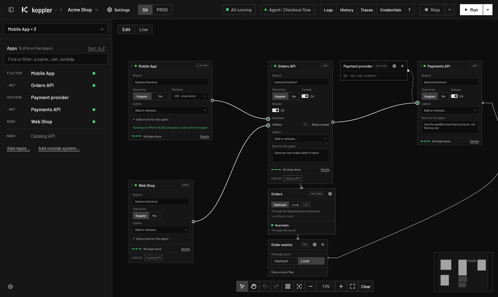
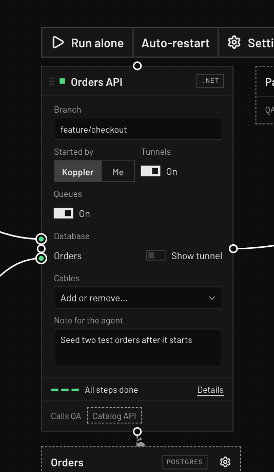
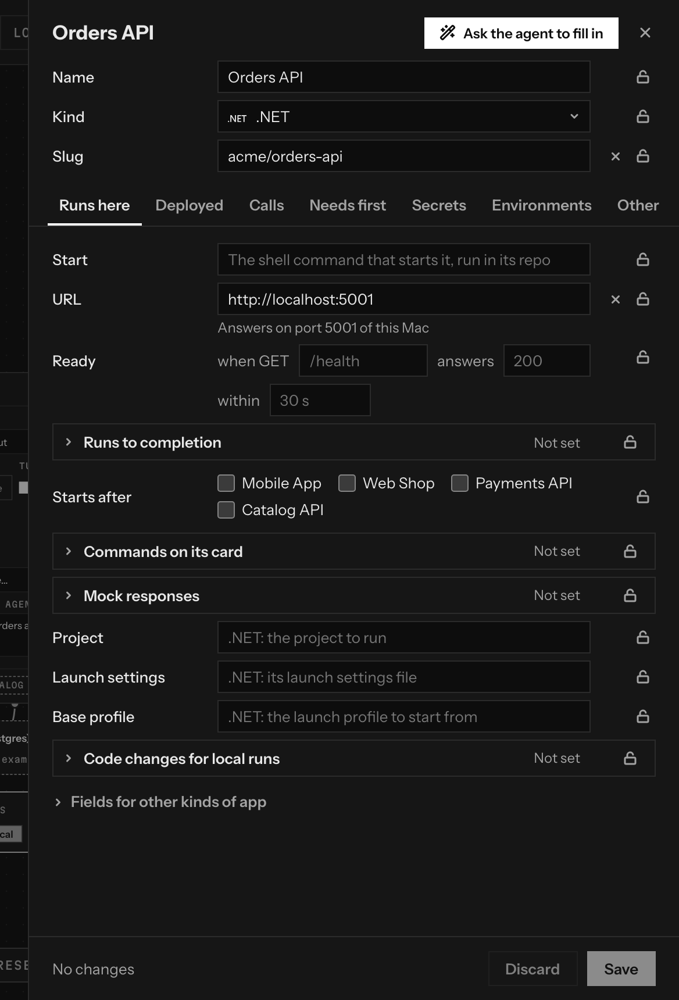
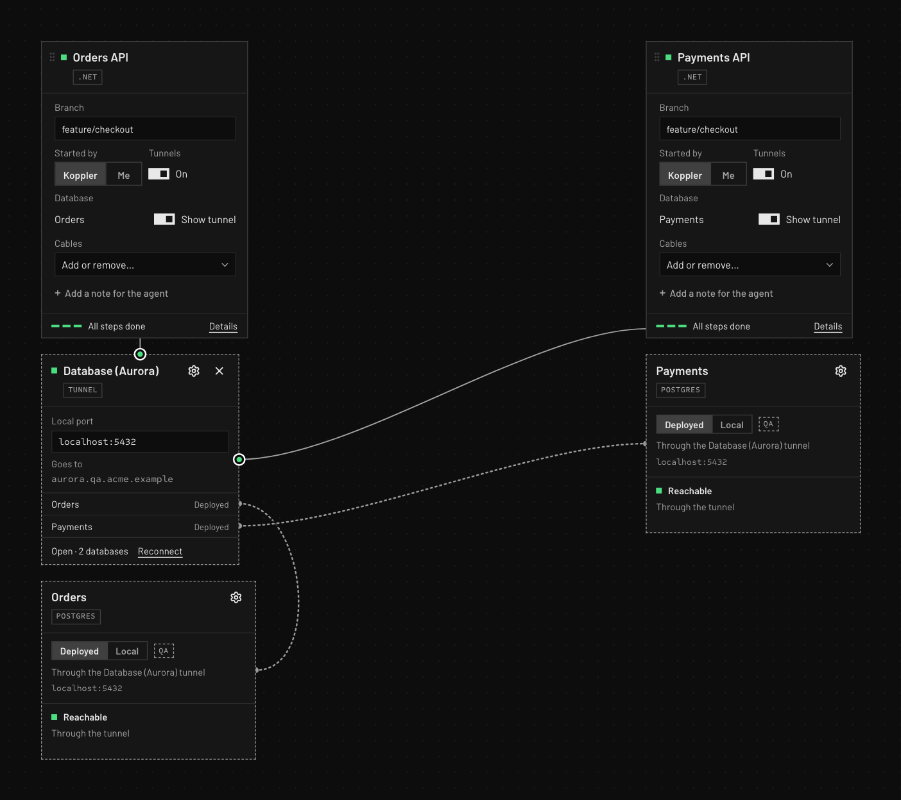
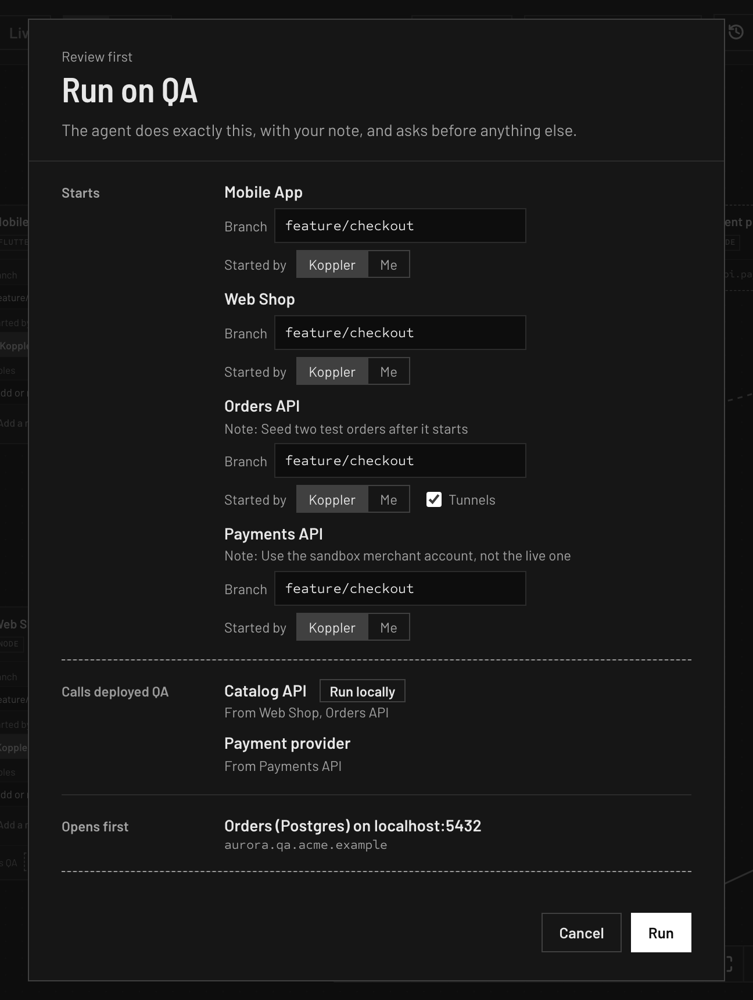
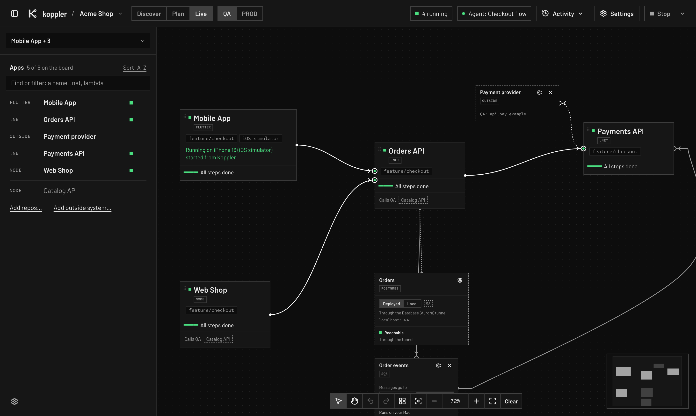
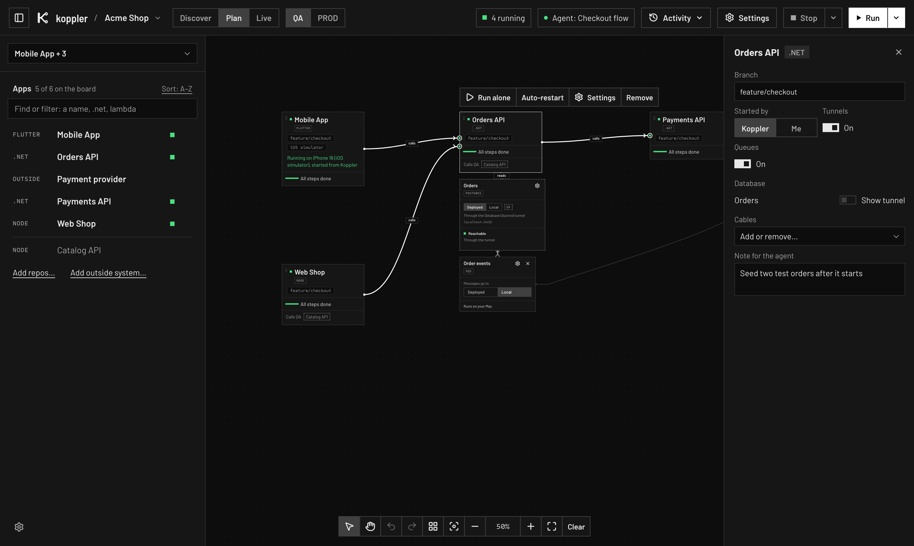

# The canvas

The canvas is a page in your browser where you build what should run, run it and watch it.
It is served on your machine only, and its address stays the same across restarts.

## Boards and team boards

The board holds the apps you want running locally.
Every board you build is saved as you change it, per stack.
Team boards are boards the stack shares with everyone who uses it; one click opens one.
A team board you change becomes your own copy.
**Share with team** proposes your board as a team board of the stack: a pull request on the stack's repo on GitHub, made from the team's `stack.json` as it is there, so nothing else on your Mac goes with it. Your team gets it once the pull request is merged.
A stack that is not on GitHub keeps the board among its team boards in its file here, for you to commit.
The same is `koppler board share "<name>"` in the terminal.
A board file can also be opened, dropped on the page or linked from GitHub.
`koppler board new "<name>"` makes a board from the terminal, and `koppler board edit "<name>"` changes one, even one open on the canvas.

## Cards

Each app is a card with:

- **Who starts it:** Koppler, from the terminal, or you, from your IDE.
- **Device**, for a mobile app: iOS simulator, Android emulator or a phone on the same Wi-Fi.
- **Branch:** the clone's branch, or another one to switch to. Uncommitted changes can be set aside or taken along, and come back on Stop.
- **Note:** an instruction for the agent about this app, such as a feature flag or a test account (needs the [agent add-on](../README.md#the-agent-add-on)).
- **Local libraries:** when another of your clones publishes a package the app depends on, the app can use your local copy instead.
- **Status, steps and log** once it runs.
  After a run starts an app, Koppler reads its log for its first 30 seconds: the **First 30 s** step says it found no errors, or shows the lines that tell of one and hands them to the agent.

Apps you have not cloned yet show greyed out, with the command to clone them.

Pointing at a card shows its actions above it: run it alone, stop or restart it while it runs, its log, its settings, and taking it off the board.

## Settings

**Settings** in a card's tools, the gear on a queue or outside system, and the gear beside the stack's name open settings: every fact the stack holds about that thing, in tabs.

- Changes are a draft until **Save**, which checks the whole stack and says where anything is wrong. **Discard** drops them, and closing with changes asks first.
- **Needs first** lists what an app needs before it runs, one row each: a tunnel, an AWS sign-in, a hosts entry, a sign-in of the stack's own, the local HTTPS certificate, a private package feed. **Add a need** asks which, then shows only that kind's fields.
- What Koppler knows is picked, not typed: the kind, the AWS profile (names from your AWS config), the project, launch settings, launch profile or script from the app's clone, the apps it calls, the queues it uses.
- **Environments** shows what each environment after the first uses: its own value, or the first one's.
- The lock beside a field keeps it as it is, for you, for commands and for the agent. Unlocking from the terminal (`koppler stack unlock`) asks you.
- **Ask the agent to fill in** has the agent read the repo and propose the empty fields; locked fields stay.

The same fields can be read and changed with `koppler stack get`, `set` and `unset`.

## Appearance

The canvas is dark, with square corners and hairlines, and colour only as a signal: one colour for what runs on your machine, one for what still calls the deployed environment, amber when something needs you, and red for PROD and failures.
The gear at the bottom of the side pane opens **Appearance**: eight schemes, five dark (Mono, the default, then Patch bay, Signal, Scope and Sodium) and three light (Paper, Blueprint and Workshop), and the local and deployed colours picked by hand over the scheme.
Warning and PROD colours are never among the picks, so a custom colour can never be mistaken for either.
PROD stays red and striped in every scheme.
Your choice is kept in this browser.
Nobody edits `stack.json` by hand.

## Cables

A cable from one card to another points the caller at the local copy of that app.
Every call without a cable goes to the deployed app of the chosen environment.

- Drag from a card's socket to another card to plug a cable.
- Let go on the empty board to drop a waypoint; click to add more, click a card to finish, press Escape to cancel.
- Slide a cable's end along its side to reorder the cables on that side.
- Pull an end away from its side to start a new cable from that port.
- Click a cable to pick it; the × in its middle, or Delete, unplugs it.
- Pick a card or a cable to see what it joins: its cables are drawn strong and the rest of the board fades.
- **Arrange** lays the board out by who calls whom.

Cables are always curves, so any board you see is one you could draw yourself.
A cable leaves its caller from a hollow ring and plugs into the app it calls at a solid socket.

## Databases, tunnels, queues and outside systems

These appear next to the app that uses them, and show or hide with it.

- **Databases** the stack names under `databases` each have a card, with a switch between **Deployed** (dashed: the environment's database, through its tunnel) and **Local** (solid: your own database on this Mac).
  The first time a database goes Local, its card asks where it runs (host, port, database name), with **Test connection**; the address is kept on this Mac only, never in the stack, and can be changed from the card or the database's settings.
  A run points each app at its local database through its setting, or the one line the stack says to change, undone on Stop. Deployed on PROD asks first.
- The tunnel card has a row per database behind it, and the line to each database leaves from its row. **Show tunnel** on an app's card draws its line through the tunnel card, or straight to the database; by default the tunnel shows when two or more apps on the board share it. A right click on a line does the same.

- **Tunnels** carry an app to a deployed database or service. Koppler opens one per host and port, shared by the apps that need it, and moves a clashing one to a free port. Each can be left out of a run, and one that runs can be restarted from its card when calls through it hang.
- **Queues** (SQS, SNS, EventBridge, Kafka) show which apps publish and read. A switch on the card picks **Deployed** (local apps use the environment's queue) or **Local** (Koppler starts an SQS emulator or a Kafka broker in Docker and points every app on that queue at it). A queue can be hidden and shown again from its app.
  What feeds a queue an app reads stacks above it, however far up: a Kafka topic piped onto an event bus, a rule forwarding to another bus, an SNS topic's subscription. Each link says how (`pipe`, `rule`, `subscription`, `rule to Lambda`); those upstream cards stay deployed.
- **Outside systems** (for example a payment provider) are dashed cards: things the apps call, or that call them, and that never run locally. Add one with **Add outside system…** under the Apps list; click it in the list to keep its card on the board even when none of its callers is there.

## Environment

The environment switch in the header lists the stack's environments.
Unplugged calls, tunnels and deployed queues follow it.
On PROD the whole page is framed in red, with a striped band under the header.

On a production environment the review shows anything that blocks the run first, keeps the plan's header and footer in view, and pressing Run there is the confirmation.
Queries against production stay in your own terminal.

## Run and Stop

**Run** shows the plan first: what starts, restarts and stops, and what you have to do before (a sign-in, a secret, a `sudo` step).
Nothing starts, stops or restarts until you confirm it there; then Koppler runs the board by itself.

With the agent add-on, Run's menu has two more ways: **Run with a note for the agent…** passes an instruction for the whole run, and **Get a checklist instead** asks the agent for a per-app checklist instead of changing anything.
The agent answers on the canvas, with buttons for its questions.
The agent chip in the toolbar says where the agent is:

- **Agent connected:** one is listening.
- **Agent working, N min:** it took a request and has not finished it.
- **Agent needs you:** it asked something; the question is in the inbox.
- **Agent quiet, N min:** it has been working for over ten minutes without a word.
- **No agent listening, N waiting:** requests wait until one connects; the plug beside it says how.

**Stop** stops what Koppler started and undoes the run: changed settings, linked libraries, switched branches.
**Stop apps, keep changes** stops the processes and leaves the changes in place.
**Shut down Koppler**, in the same menu, stops everything and the canvas too.

## Views and shortcuts

**Edit** shows every field of a card; **Live** shows what runs, with short cards.

Zoomed out below 60%, cards are short in Edit too: pick one and its fields open in a panel on the right of the board, where they change the card as they would on it. The × or a click on the empty board closes it.

**Present** shows the board alone, full screen.

| Key | What it does |
|---|---|
| `E` / `L` | Edit view, Live view |
| `P`, then `Esc` | Present, and back |
| `F` | Fit the board in the window |
| `V` / `H`, or hold `Space` | Select by dragging, or move around: while moving around, a click or drag never picks, lets go of or moves a card |
| `Ctrl+Z` / `Shift+Ctrl+Z` (`Cmd` on a Mac) | Undo, redo |
| `Tab`, arrows | Move between cards, and move the picked card |
| `Delete` | Take the picked cards off the board |
| `Ctrl+Enter` (`Cmd` on a Mac) | Run |
| `?` | All shortcuts |

## Side panels

- **Credentials:** the secrets the apps on the board need for this environment. Set, test or remove a value; a value is never shown.
- **Flow check:** tests every connection of the running board; with the agent add-on, it can hand failures to the agent to explain.
- **History:** recent runs and Stops and how each ended.
- **Logs:** each app's log opens as a tab under the board.
  The All apps tab shows every app on the board in one stream, in the order the lines came, each with the app's name in its colour.
  The apps are tags above it: click one to leave it out or bring it back, and the pencil gives it a short name of your own in this log, kept with the board.
  Times are to the millisecond; one marked `~` is when Koppler first read the line, for a log Koppler did not write.
